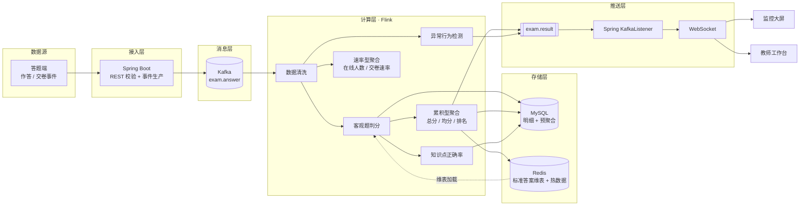

# 基于 Flink 的 408 在线模考实时阅卷数据流处理与大屏监控

<p align="left">
  
  
  
  
  
  
  
</p>

针对 408 在线模考中**阅卷反馈慢、学情统计滞后、考试监控粒度粗、异常作答无法实时发现**四个问题，构建一条"作答事件 → 实时判分 → 学情聚合 → 大屏推送"的流式链路。

系统以考生答题、交卷事件为数据源，Kafka 承载数据流，Flink 完成**数据清洗、客观题自动判分、成绩聚合、知识点正确率统计与异常行为检测**；结果落 MySQL / Redis，经 WebSocket 推送到可视化大屏。主观题采用**规则辅助打分 + 人工复核**，控制项目复杂度。

> 本仓库为本科毕业设计工程实现，当前处于**数据准备完成、流处理开发启动**阶段。详见 [路线图](#路线图)。

---

## 系统架构



三处关键设计：

| 设计 | 原因 |
|---|---|
| **结果回推走 `exam.result` topic** | 不用轮询。Flink Sink 除写库外再发一份结果事件，Spring 收到即广播，链路真正实时且天然解耦 |
| **累积型 / 速率型双通道聚合** | 均分排名用 upsert 覆盖（幂等），在线人数用窗口计算。混在一起会让"窗口重放导致分数翻倍" |
| **结果表一律 upsert** | checkpoint 恢复会重放数据，`score += x` 会让总分翻倍。主键 `(exam_id, knowledge_point_id)` 写当前值而非增量，做到"至少一次语义 + 幂等写 = 效果上精确一次" |

---

## 目录结构

```
.
├── .github/                 # CI 与协作模板
│   ├── workflows/           # GitHub Actions
│   ├── ISSUE_TEMPLATE/      # Issue 模板
│   └── pull_request_template.md
├── data/                    # 数据集（原始与生成物不入库，种子数据入库）
│   ├── raw/                 # 原始真题 PDF，120MB，gitignore
│   ├── seed/                # 人工维护的种子数据：答案、知识点复核
│   └── generated/           # 脚本生成物：结构化题库，gitignore
├── deploy/                  # 部署编排（compose 在 M2 补充，当前仅约定端口与初始化方式）
├── docs/                    # 设计与数据文档
│   ├── architecture/        # 数据流程图、页面与路由规划
│   └── data/                # 数据源与加工说明
├── exam-server/             # Spring Boot 服务端（REST + Kafka 生产/消费 + WebSocket）
├── exam-web/                # Vue 3 前端（答题端 + 教师工作台 + 监控大屏）
├── flink-jobs/              # Flink 流处理作业
├── sql/                     # 建表与种子数据脚本
└── tools/                   # 题库数据加工脚本（Python）
```

`exam-server/`、`exam-web/`、`flink-jobs/` 三个模块目前只有 README 约定职责与接口，代码在 M3–M5 阶段填充。每个目录下的 `README.md` 说明该模块的边界、约定与当前状态。

---

## 快速开始

### 1. 克隆与准备数据

```bash
git clone https://github.com/Enrrish/flink-408-realtime-exam-grading.git
cd flink-408-realtime-exam-grading

# 下载原始真题（120MB，不入库；若报 schannel 证书吊销错误则加 GIT_SSL_NO_VERIFY=1）
git clone --depth 1 https://github.com/neville-studio/408-exam-paper.git data/raw/408-exam-paper

# 安装脚本依赖
pip install -r tools/requirements.txt

# 重新生成题库（也可直接使用已入库的 sql/02_question_seed.sql）
python tools/parse_408.py
```

### 2. 初始化数据库

```bash
mysql -u root -p < sql/01_question_bank.sql   # 建库建表 + 知识点字典
mysql -u root -p < sql/02_question_seed.sql   # 导入 5 套真题（235 题）
```

### 3. 启动基础设施

```bash
cd deploy && cp .env.example .env && docker compose up -d
```

### 4. 启动应用

```bash
# 服务端
cd exam-server && mvn spring-boot:run
# 前端
cd exam-web && npm install && npm run dev
```

> 各模块的详细启动方式见其自身 `README.md`。

---

## 数据基础

题库口径为 **2022–2026 共 5 套 408 统考真题**，合计 **235 题**：

| 指标 | 数值 |
|---|---|
| 单选题 | 200（40 题 × 5 套） |
| 综合应用题 | 35（7 题 × 5 套，含 104 个小问） |
| 客观题答案 | 200 / 200（100%） |
| 知识点标签 | 235 / 235（100%，其中 50 道经人工复核） |
| 单套总分 | 150 分（5 套全部校验通过） |

数据来源、加工流程、答案补录的两条通道与知识点复核方法，见 [数据源说明](docs/data/data-source.md)。

> **版权说明**：真题版权归教育部教育考试院所有。本仓库仅将解析结果作为学术测试数据集使用，不对外分发原始题干；如需公开传播，请仅使用自建题目。

---

## 设计文档

| 文档 | 内容 |
|---|---|
| [数据流程图](docs/architecture/data-flow.html) | 系统总体数据流，含双通道聚合与结果回推链路（A4 横向可打印） |
| [页面结构与路由规划](docs/architecture/page-routes.md) | 路由表、四套布局策略、前后端接口与 WebSocket 消息约定 |
| [数据源说明](docs/data/data-source.md) | 题库来源、解析流程、答案补录与知识点复核、遗留问题 |

---

## 路线图

- [x] **M0 可行性论证与技术选型** — 架构评审、延迟预算核算、版本落地
- [x] **M1 数据准备** — 真题解析、答案补录、知识点复核、种子 SQL
- [ ] **M2 环境与建模** — docker-compose 编排、作答事件与聚合表结构
- [ ] **M3 接入层** — Spring REST、Kafka 生产、答题端、考生行为模拟器
- [ ] **M4 流处理核心** — 清洗、判分、双通道聚合、知识点统计、幂等 Sink
- [ ] **M5 推送与大屏** — 结果回推、WebSocket、监控大屏
- [ ] **M6 异常检测** — ProcessFunction + ValueState 规则引擎
- [ ] **M7 测试与论文实验** — 压测、端到端延迟度量、实验数据

---

## 技术选型说明

| 组件 | 版本 | 选择理由 |
|---|---|---|
| Flink | 1.20 LTS | 中文资料最多、生态成熟；2.x 需 JDK 17 且教程稀少，会拖进度 |
| Kafka | 3.x | 与 Flink 1.20 连接器稳定匹配，`exam.answer` 按 examId 单分区保证场内有序 |
| Spring Boot | 2.7 | 与 JDK 11 配套，Kafka / WebSocket 支持完善 |
| Vue 3 + DataV | 3.x / `@kjgl77/datav-vue3` | 官方 DataV 仅支持 Vue 2，社区重写版可直接使用 |
| 时间语义 | ProcessingTime 优先 | 先跑通链路，论文中讨论 EventTime + Watermark 作为改进 |

---

## 贡献

本项目为单人毕业设计，暂不接受外部 PR。提交规范、分支策略与本地校验方式见 [CONTRIBUTING.md](CONTRIBUTING.md)。

## 许可证

代码以 [MIT License](LICENSE) 发布。数据集的使用限制见 [数据源说明](docs/data/data-source.md) 中的版权说明，不适用 MIT 条款。
